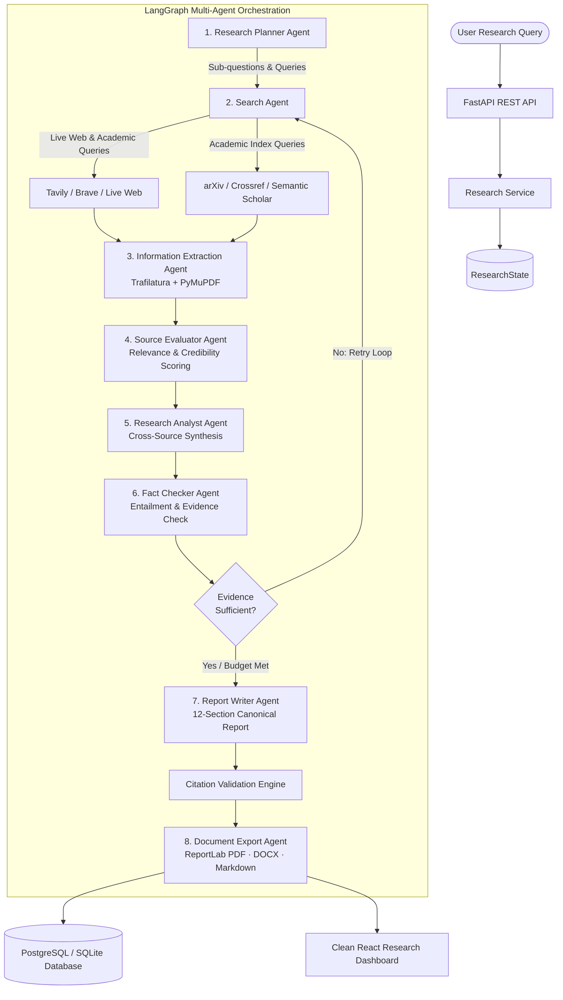

<div align="center">

# 🔬 ResearchAgent
### Autonomous Multi-Agent AI Research Automation Platform

[](https://python.org)
[](https://fastapi.tiangolo.com)
[](https://langchain.com)
[](https://react.dev)
[](https://tailwindcss.com)
[](https://postgresql.org)
[](LICENSE)

**An enterprise-grade, end-to-end research automation engine that accepts complex research questions, designs targeted investigative plans, retrieves live web and academic sources, extracts full-text content, fact-checks claims against empirical passages, and generates publication-ready reports with traceable citations.**

[Key Highlights](#-key-engineering-highlights) •
[Architecture](#-multi-agent-system-architecture) •
[Agent Workflow](#-agent-responsibilities) •
[Tech Stack](#-technology-stack) •
[Quickstart](#-quickstart-in-60-seconds) •
[Testing](#-testing--verification)

</div>

---

## ⚡ Key Engineering Highlights

* **100% Real Integrations (Zero-Mock Policy)**: No simulated search results, dummy agent outputs, or fabricated citations. Every query hits live web engines and public academic databases.
* **Stateful Multi-Agent Orchestration**: Built with **LangGraph** using typed state machines and conditional cyclical loops (evaluates evidence sufficiency; if gaps exist, refines queries and re-triggers search within bounded budgets).
* **Automated Fact-Checking & Entailment**: Atomizes synthesized findings into verifiable claims and cross-examines them against retrieved text passages with 4 explicit statuses:
  $$\text{Claim Status} \in \{\texttt{supported}, \texttt{partially\_supported}, \texttt{contradicted}, \texttt{insufficient\_evidence}\}$$
* **Live Academic Index Discovery**: Direct live integrations with **arXiv** (pre-prints), **Crossref** (peer-reviewed DOIs), and **Semantic Scholar** (citation metadata).
* **Deep Document & Web Extraction**: Uses **Trafilatura** for article extraction and **PyMuPDF** (`pymupdf`) for direct multi-page PDF text mining.
* **Traceable, Hallucination-Free Citations**: Validates all report bibliography entries against retrieved database records before finalizing the canonical report.
* **Multi-Format Export Pipeline**: Generates canonical Markdown, professional **ReportLab PDF** reports (with running headers, footers, and page numbers), and structured **python-docx Word** files.
* **Real-Time SSE Streaming**: Live Server-Sent Events (SSE) stream agent thoughts, execution milestones, and progress bars directly to the web dashboard.

---

## 🏗️ Multi-Agent System Architecture



---

## 🤖 Agent Responsibilities

| Agent | Responsibility | Core Technology |
|---|---|---|
| **1. Research Planner** | Deconstructs topic into MECE sub-questions and targeted queries | LLM (Gemini / OpenAI), Pydantic |
| **2. Research Search** | Executes parallel queries against web and academic indexes | Tavily, Brave, arXiv API, Crossref |
| **3. Information Extractor** | Parses full article text, strips boilerplate, and mines PDFs | Trafilatura, PyMuPDF, HTTPX |
| **4. Source Evaluator** | Separately scores topical relevance and source credibility | Multi-metric Heuristics & Metadata |
| **5. Research Analyst** | Synthesizes evidence across sources; maps consensus & debate | LLM, Structured Synthesis |
| **6. Fact Checker** | Verifies claim entailment against exact extracted passages | NLI Verification, Source Anchoring |
| **7. Report Writer** | Compiles 12-section canonical report with clickable citations | Publication-grade LLM generation |
| **8. Export Generator** | Produces production-ready PDFs, Word docs, and Markdown | ReportLab, python-docx |

---

## 🛠️ Technology Stack

| Layer | Technologies |
|---|---|
| **Frontend** | React 18, TypeScript, Vite, Tailwind CSS, Lucide Icons |
| **Backend Framework** | Python 3.12+, FastAPI, Pydantic v2, HTTPX |
| **Orchestration** | LangGraph (StateGraph), LangChain Core |
| **LLM Providers** | Google Gemini (1.5 Flash / Pro), OpenAI (GPT-4o), Ollama |
| **Web & Academic Search** | Tavily Search API, Brave Search API, arXiv API, Crossref API, DuckDuckGo |
| **Content Extraction** | Trafilatura, PyMuPDF (`fitz`), BeautifulSoup4 |
| **Database & Persistence** | PostgreSQL (with pgvector) / Async SQLite + SQLAlchemy 2.0 |
| **Document Generation** | ReportLab (Binary PDF), python-docx (Word) |
| **DevOps & Containers** | Docker, Docker Compose, GitHub Actions |

---

## 🚀 Quickstart in 60 Seconds

### Prerequisites
* Python 3.11+
* Node.js 20+

### 1. Clone & Configure
```bash
git clone https://github.com/iitking/agent-to-automate-your-research.git
cd agent-to-automate-your-research
cp .env.example .env
```
*(Add your `GEMINI_API_KEY` or `OPENAI_API_KEY` to `.env`, or configure them directly inside the web settings modal).*

### 2. Launch Application
You can run the full-stack system with a single command:
```bash
chmod +x scripts/start.sh
./scripts/start.sh
```

* **Web Research Dashboard**: [`http://localhost:8000`](http://localhost:8000)
* **Interactive API Documentation (Swagger)**: [`http://localhost:8000/docs`](http://localhost:8000/docs)

*(Optional) For independent frontend development with hot-reload:*
```bash
cd frontend && npm run dev  # Runs on http://localhost:5173
```

---

## 🧪 Testing & Verification

The platform includes automated unit tests and live external integration tests:

```bash
# Run unit tests (Schemas, URL Sanitization, Citation Grounding, PDF/DOCX Generators)
PYTHONPATH=backend backend/.venv/bin/pytest backend/tests/unit

# Run live integration tests (Real live queries to arXiv, Crossref, and Trafilatura)
PYTHONPATH=backend backend/.venv/bin/pytest backend/tests/integration
```

**Live Test Results**:
```text
backend/tests/unit/test_citation_validator.py ..... PASSED [25%]
backend/tests/unit/test_generators.py ............. PASSED [50%]
backend/tests/unit/test_url_validator.py .......... PASSED [100%]
backend/tests/integration/test_arxiv.py ........... PASSED [33%]
backend/tests/integration/test_crossref.py ........ PASSED [66%]
backend/tests/integration/test_extraction.py ...... PASSED [100%]
```

---

## 📂 Project Structure

```text
agent-to-automate-your-research/
├── frontend/                     # Clean React + Vite + Tailwind UI
│   ├── src/
│   │   ├── components/           # Dashboard, Monitor, SourceExplorer, ReportViewer
│   │   ├── services/api.ts       # REST client & Server-Sent Events listener
│   │   ├── types/                # TypeScript data interfaces
│   │   └── App.tsx               # Main application coordinator
│   └── package.json
├── backend/                      # Production FastAPI Application
│   ├── app/
│   │   ├── agents/               # Planner, Search, Extractor, Analyst, FactChecker, Writer
│   │   ├── graph/                # LangGraph StateGraph & conditional edge routing
│   │   ├── tools/                # Tavily, arXiv, Crossref, Trafilatura, PDF, DOCX generators
│   │   ├── services/             # LLM provider adapter, Research service, Embeddings
│   │   ├── database/             # SQLAlchemy async models & SQLite/Postgres connection
│   │   ├── api/routes/           # REST endpoints (/research, /config, /health)
│   │   └── main.py               # Application entrypoint & static frontend mount
│   ├── tests/                    # Unit and live external integration test suites
│   └── requirements.txt
├── docker-compose.yml            # Multi-container deployment (API, Frontend, Postgres, Redis)
├── scripts/start.sh              # Single-command launch script
└── README.md
```

---

## 🛡️ Non-Negotiable Integrity Rules

1. **No Hallucinated Citations**: Every reference must resolve to an actual retrieved URL and metadata record in the database.
2. **Explicit Failure Handling**: Missing API keys or network timeouts trigger structured error messages; the system never substitutes dummy strings.
3. **SSRF & Input Defense**: All user-provided and discovered URLs undergo private-range filtering (rejects `127.0.0.1`, `localhost`, AWS metadata endpoints).

---

## 👨‍💻 Author

<div align="center">

<a href="https://github.com/iitking">
  
</a>

### **Nivesh Kumar Meena**

**AI Architect · MLOps Engineer** | B.Tech Electrical Engineering, **IIT Roorkee**

*Building agentic AI systems, RAG pipelines and production-ready ML.*

<a href="https://www.linkedin.com/in/nivesh-kumar-meena-a31465221/"></a>
<a href="https://github.com/iitking"></a>
<a href="mailto:niveshkr149@gmail.com"></a>

<br/><br/>

⭐ **If you found this project useful, please give it a star!** ⭐

<sub>Open to AI/ML engineering opportunities and collaborations.</sub>

</div>

---

<div align="center">
  <sub>Made with ❤️ by <a href="https://github.com/iitking">Nivesh Kumar Meena</a> · © 2026 · MIT License</sub>
</div>

